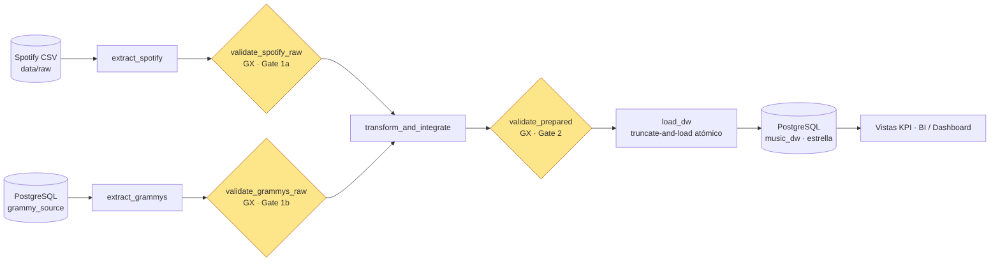

# Arquitectura

## Arquitectura conceptual (patrón de pipeline confiable, §4.2)

**Qué responde cada compuerta:** *Gate 1* → ¿pueden estos datos entrar a la transformación? · *Gate 2* → ¿produjo la
transformación datos aptos para cargar? (`load_dw` solo corre si Gate 2 no tiene fallas Critical).

## DAG implementado (`dags/reliable_music_pipeline.py`)

| Task | Función | Entrada → Salida | Retries |
|---|---|---|---|
| `extract_spotify` | Lee el CSV sin limpiar | CSV → `staging/<batch>/spotify_raw.parquet` + metadatos | 1 × 10 s |
| `validate_spotify_raw` | Gate 1a (suite `spotify_raw_suite`) | parquet → `validation_spotify_raw.json` | 0 |
| `extract_grammys` | Extrae **desde PostgreSQL** (no del CSV) | tabla `grammy_awards` → `grammys_raw.parquet` | 3 × 20 s exp. |
| `validate_grammys_raw` | Gate 1b (suite `grammys_raw_suite`) | parquet → `validation_grammys_raw.json` | 0 |
| `transform_and_integrate` | Limpieza + integración + reconciliación | 2 parquet → `prepared_integrated.parquet` + `reconciliation.json` | 0 |
| `validate_prepared` | Gate 2 (suite `prepared_suite`) | parquet preparado → `validation_prepared.json` | 0 |
| `load_dw` | Carga atómica al DW + vistas KPI | parquet preparado → `music_dw` + `load_summary.json` | 2 × 30 s |

Dependencias: las dos ramas son independientes y convergen en `transform_and_integrate` (regla `all_success`).
Si una rama falla, la otra sigue ejecutándose, pero la transformación queda en `upstream_failed`.

## Componentes de infraestructura (docker-compose)

| Servicio | Rol |
|---|---|
| `airflow-apiserver` (8080) | UI y API de Airflow 3.1.8 |
| `airflow-scheduler` | Planifica y ejecuta tareas (LocalExecutor) |
| `airflow-dag-processor` | Parsea los DAGs (componente propio en Airflow 3) |
| `airflow-db` | Metadatos de Airflow (no datos del negocio) |
| `warehouse-db` (5433 en el host) | Postgres con `grammy_source` (fuente) y `music_dw` (DW) |
| `metabase` *(opcional, perfil `bi`)* | BI sobre el DW |

## Decisión de diseño: interfaz entre tareas
Las tareas pasan solo **rutas y metadatos compactos** (≈1 KB por XCom). Los datos masivos viajan por archivos Parquet en
`data/staging/<batch_id>/`, nunca por la base de metadatos de Airflow (requisito §6.11).

## Estructura de GX (`gx/`)
`Data Source pandas → Data Asset <capa>_asset → Batch Definition <capa>_whole_df → Expectation Suite <capa>_suite →
Validation Definition <capa>_validation → Checkpoint <capa>_checkpoint`. Mapeo regla ↔ expectation: `docs/gx_expectation_map.md`.
