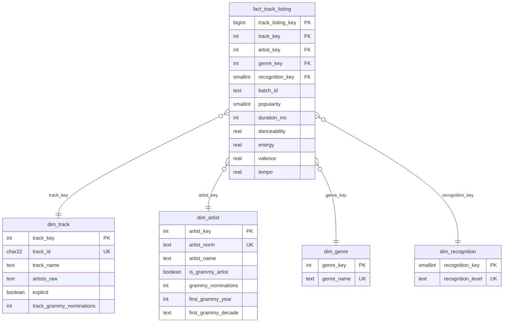

# Modelo dimensional (Sección 6.4)

| Decisión | Contenido |
|---|---|
| **Proceso de negocio** | Presencia de pistas de Spotify en géneros, enriquecida con el reconocimiento Grammy del artista/canción. |
| **Grano** | **Una fila = una pista de Spotify (`track_id`) en un género (`track_genre`)**. Es el grano de la fuente tras deduplicar el par. |
| **Dimensiones** | `dim_track` (qué pista), `dim_artist` (artista principal + atributos Grammy), `dim_genre`, `dim_recognition` (3 niveles: *No Grammy link*, *Artist Grammy-linked*, *Track Grammy-linked*). |
| **Medidas** | `popularity`, `duration_ms`, `danceability`, `energy`, `valence`, `acousticness`, `instrumentalness`, `liveness`, `speechiness`, `loudness`, `tempo` (todas a nivel pista-género; tempo/duración admiten NULL). |
| **Llaves** | PK surrogate entera (SERIAL) en cada dimensión y en el hecho; **business keys** con UNIQUE: `track_id`, `artist_norm`, `genre_name`, `recognition_level`. FKs con integridad referencial en el hecho. |
| **Restricciones** | `UNIQUE(track_key, genre_key)` en el hecho (impide duplicados en reruns); `CHECK popularity 0-100`; `CHECK tempo > 0`. |
| **Bitácora** | `etl_batch_log` (no se trunca): lote, fecha, estado y conteos de cada carga. |

**Atributos Grammy en `dim_artist`:** `is_grammy_artist`, `grammy_nominations`, `grammy_wins`, `first_grammy_year`, `first_grammy_decade`
(derivados de la integración; se tratan como atributos descriptivos del artista, tipo SCD-1).

## Cómo cada requisito queda soportado

| Requisito | Hecho / dimensiones | Consulta (vista) |
|---|---|---|
| AR-1 | `fact_track_listing` ⨝ `dim_recognition` | `vw_kpi_popularity_by_recognition` |
| AR-2 | `fact_track_listing` ⨝ `dim_genre` ⨝ `dim_recognition` | `vw_kpi_genre_grammy_share` |
| AR-3 | `fact_track_listing` ⨝ `dim_artist` (`first_grammy_decade`) | `vw_kpi_popularity_by_grammy_decade` |

DDL ejecutable: `sql/dw_schema.sql`. Vistas: `sql/kpi_queries.sql`.
